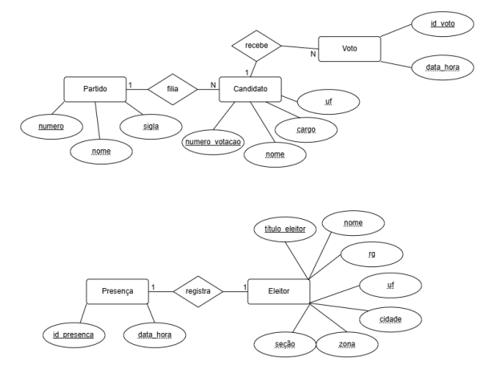

  
  <h1>🗳️ Sistema de Eleição - Modelagem de Dados</h1>
  
<i>Estrutura Relacional para Controle de Partidos, Candidatos, Eleitores, Presenças e Votos</i>

  
  
  

---

## 🗺️ Diagrama Entidade-Relacionamento (DER)

Abaixo está a representação visual do modelo de banco de dados, focando no registro de presença dos eleitores, na apuração dos votos por candidato e na filiação dos candidatos aos partidos.

  
   
  

---

## 📦 Entidades Principais

O modelo é composto por cinco tabelas, definidas no arquivo `Eleicao.sql` (DBML):

<table>
  <tr>
    <td align="center" width="120"><h1>🏛️</h1><b>Partido</b></td>
    <td>Registra as legendas participantes: <code>Numero_identificador</code> (Chave Primária, <code>decimal(2,0)</code>), <code>Nome</code> e <code>Sigla</code>.</td>
  </tr>
  <tr>
    <td align="center"><h1>🧑‍💼</h1><b>Candidato</b></td>
    <td>Armazena os concorrentes através do <code>Id_candidato</code> (Chave Primária), com <code>Nome_completo</code>, <code>Numero_Urna</code> (Garantido como único), <code>Cargo</code>, <code>UF</code> e <code>Partido_Filiado</code>.</td>
  </tr>
  <tr>
    <td align="center"><h1>🪪</h1><b>Eleitor</b></td>
    <td>Mantém o cadastro de quem vota, identificado pelo <code>numero_titulo</code> (Chave Primária), com <code>Nome</code>, <code>RG</code>, <code>UF</code>, <code>Cidade</code>, <code>Zona</code> e <code>Seção</code>.</td>
  </tr>
  <tr>
    <td align="center"><h1>✅</h1><b>Presenca</b></td>
    <td>Controla o comparecimento do eleitor à urna: <code>ID_Urna</code> (Chave Primária), <code>numero_titulo</code> e <code>Data_Hora</code> do registro.</td>
  </tr>
  <tr>
    <td align="center"><h1>🗳️</h1><b>Votos</b></td>
    <td>Registra cada voto computado através do <code>Id_voto</code> (Chave Primária), com o <code>Nome_completo</code> do candidato escolhido e a <code>Data_hora</code>.</td>
  </tr>
</table>

---

## 🔗 Mapeamento de Relacionamentos (Foreign Keys)

A estrutura de relacionamentos (chaves estrangeiras) segue as seguintes regras de cardinalidade:

-  **Eleitor ↔ Presenca:** Relação de um para muitos (`1:N`). O título do eleitor referencia seus registros de presença `(Eleitor.numero_titulo < Presenca.numero_titulo)`.
-  **Candidato ↔ Votos:** Relação de muitos para muitos (`N:N`), conforme definida no script `(Candidato.Nome_completo <> Votos.Nome_completo)`.
-  **Partido ↔ Candidato:** Relação de muitos para muitos (`N:N`), conforme definida no script `(Partido.Nome <> Candidato.Partido_Filiado)`.

> Nos relacionamentos acima, o símbolo `?` do arquivo `.sql` indica participação opcional (o lado pode não ter registros associados).

---

## 📝 Observações sobre o Modelo

Pontos que valem uma revisão em uma próxima versão do diagrama:

- **Sigilo do voto:** a tabela `Votos` não referencia `Eleitor`, e a presença é registrada à parte em `Presenca`. Isso é uma boa decisão, pois impede ligar um voto a uma pessoa.
- **Chaves dos relacionamentos:** `Candidato ↔ Votos` usa `Nome_completo`, e `Partido ↔ Candidato` usa `Nome`. Nenhum dos dois é chave primária ou único, e nomes podem se repetir. O mais seguro é relacionar por `Id_candidato` e `Numero_identificador`.
- **Cardinalidade:** na prática, um voto pertence a **um** candidato e um candidato pertence a **um** partido, então ambos tendem a ser `1:N` (e não `N:N`). Isso evita a necessidade de uma tabela intermediária.
- **Tamanhos incompatíveis:** `Candidato.Partido_Filiado` é `varchar(15)`, mas `Partido.Nome` é `varchar(100)`. Uma chave estrangeira entre colunas de tamanhos diferentes pode truncar nomes longos.
- **Votos em branco e nulos:** como `Votos` guarda o nome do candidato, não há como representar esses casos. Um `Id_candidato` opcional ou um tipo de voto resolveria.

---

  <i>Desenvolvido para modelagem e documentação de estrutura de dados relacional.
  FEITO POR ARTHUR E JOÂO VITOR</i>

